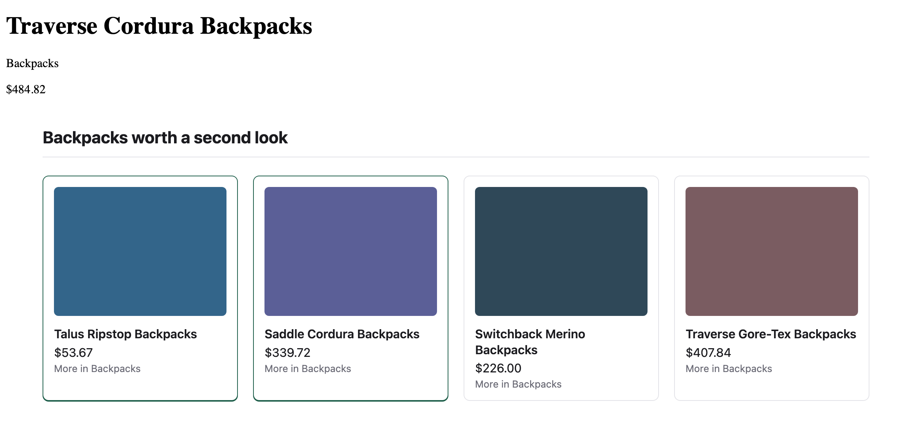

# [rudra-js](https://rudrajs.com) &middot; [](https://github.com/clivedsouza1010/rudra-js/blob/main/LICENSE) [](https://www.npmjs.com/package/@rudra-js/core)
[](https://demo.rudrajs.com/product/RJ-00001?shopper=S-0001)

rudra-js is an open-source TypeScript library for generating dynamic product recommendations. 

You specify the tracking input to the generator, rudra-js does all the work. 
- Send the sanitized data to an LLM (Large Language Model).
- The LLM will design one product-recommendation block and send it back in the response for a product page.
- rudra-js checks it against your catalog, and React renders it.


If a language model is allowed to write raw HTML, it can make up a price. It can also show a product
you don't sell. That is why rudra-js will not let the model write HTML at all. The model has to
return a spec instead: a short description of the block, made up only of fields rudra-js defines. It
picks the layout and writes the headline and copy, but there isn't a field for a price, a product
name, an image or a link. To name a product, it will have to use a SKU from the list you give it.



`@rudra-js/react` will turn the spec into HTML. To do this, it will read the title, price, image and
link of the products from your catalog as the page is served. Anything the model wrote will be
rendered as escaped text.

rudra-js also checks all of the words the model writes, in three passes:

- Patterns for prices, discounts, ratings, delivery dates and stock counts.
- A digit check. All digits in a sentence have to come from your input, as a category or a tag on a
  product the model was shown.
- A list of claims that carry no number to check, like "top pick" and "customer favourite".

Any field that fails a pass will be dropped.

Two of the passes are just word lists. This means a rewording that is on neither list will get
through. A number spelled out in words will also get past the digit check, as this check can only
read digits. For example, "Four and a half stars from other hikers" gets past all three passes. You
can go and see how big the gap is: the tests keep a list of rewordings that still pass. That's why
the real defence is structural: the model will never be told a price and there's nowhere in the spec
to put it.

This block is part of the first HTML response and doesn't need any client-side JavaScript. Even a
crawler that never runs JavaScript will read it.

On our 500-shopper benchmark, the default mode makes 460 model calls per 1,000 page views. That
would be 1,000 if you generated for each shopper.

> **Status: `0.9.1`, early.** It installs and it works: the Getting started below runs as a test on
> every commit. But the public API might still change between minor versions before `1.0`. Any
> change like this will be in the changelog.

## Getting started

You don't need an API key to start. If you leave the provider out, `@rudra-js/core` will build the
block itself (with no model). 

```sh
npm install @rudra-js/core@latest @rudra-js/react@latest @rudra-js/attested@latest
```

Just use this one command for a new app and for an app that already uses rudra-js. It's also how you
upgrade. If your app has `@rudra-js/anthropic`, you will need to add it to the command with
`@latest` too. For `@rudra-js/a2ui`, use the install line in the README of that package instead.
This line also names the two A2UI packages.

You will need React 18 or 19, but not Server Components. `@rudra-js/react` is just plain React with
no hooks. It will work with `renderToString` and in a client-rendered app. If your framework
supports Server Components, it can be used as one too. To put the block in the first HTML response,
you have to render it on the server.

You also need Node 22.12 or later.

```tsx
import { createComponentGenerator, parseTrackingInput } from '@rudra-js/core';
import { RudraComponent } from '@rudra-js/react';

const catalog = [
  { sku: 'A-1', title: 'Cast iron skillet', category: 'Cookware', price: 39, currency: 'USD' },
  { sku: 'A-2', title: 'Enamel dutch oven', category: 'Cookware', price: 89, currency: 'USD' },
  { sku: 'A-3', title: 'Chef knife', category: 'Knives', price: 55, currency: 'USD' },
];

async function recommendations() {
  // Passing no provider means no API key.
  // Core builds the block itself, and the same input always gives the same block.
  const generator = createComponentGenerator({ provider: null });

  // Parsing fills in what you left out and rejects anything that doesn't belong.
  // Always pass the parsed candidates to the renderer, not your raw objects.
  const input = parseTrackingInput({
    user: { id: 'shopper-1' },
    context: { surface: 'pdp', currentSku: 'A-1', currentCategory: 'Cookware' },
    candidates: catalog,
    signals: { cart: [{ sku: 'A-2', at: Date.now() }] },
  });

  const spec = await generator.generate(input);

  return <RudraComponent spec={spec} products={input.candidates} locale="en-US" />;
}
```

With this sample, a shopper looking at the skillet with the dutch oven already in their cart will be
shown the knife, under the heading "Goes with your cart". They won't be shown the product they're
viewing or the one in their cart. No model will be asked and nothing will be billed.

In Next.js, add `export default recommendations` at the bottom of the sample to turn it into a page.

New Next.js apps from `create-next-app` have Cache Components turned on. This will stop the build
with "Next.js encountered the unstable value `Date.now()` while prerendering", because the sample
and `generate` read the clock while the page renders. To fix this, you can create the app with
`npx create-next-app@latest my-app --yes --no-cache-components`. You can also delete
`cacheComponents: true` and `partialPrefetching: true` from `next.config.ts`. There's more in the
[quick start](https://rudrajs.com/learn/quick-start#cache-components).

When you're ready for a model, add [`@rudra-js/anthropic`](packages/anthropic) and pass it as the
`provider`. Everything else above stays the same. The model will then write the wording. It will
also pick the layout and the emphasis. By default, the products in a grid or carousel will still be
picked by core. This is done per request, from the candidates you pass in.

If you're going to send real shopper traffic, read
[Running it in a regulated shop](packages/core#running-it-in-a-regulated-shop) first.

You don't have to use the Anthropic adapter: any model can be put behind the small interface
described in [Any provider](packages/core#any-provider).

If an [A2UI](https://a2ui.org) agent builds your pages, add [`@rudra-js/a2ui`](packages/a2ui) too.

## Packages

| Package                                     | What it does                                                                                                                                                                    |
| ------------------------------------------- | ------------------------------------------------------------------------------------------------------------------------------------------------------------------------------- |
| [`@rudra-js/core`](packages/core)           | The schemas and logic that turn a tracking input into a spec you can render in your code. The spec is checked with `@rudra-js/attested`.                                                 |
| [`@rudra-js/react`](packages/react)         | Renders the spec with React, on the server or in the browser.                                                                                                                   |
| [`@rudra-js/anthropic`](packages/anthropic) | Connector to the Anthropic API.                          |
| [`@rudra-js/attested`](packages/attested)   | validates the model output against the app facts. Has no dependencies.                                                                                            |
| [`@rudra-js/a2ui`](packages/a2ui)           | Puts the block in an [A2UI](https://a2ui.org) interface: an agent places it in React, or your server sends it to any other A2UI renderer. Your server still picks the products. |

## Development

You need Node `>=22.12` to work on this repo.

```sh
nvm use
npm install

npm run check        # all six of the below, in order

npm run build        # tsc -b across the workspace
npm run typecheck    # includes test files, which the build does not
npm run lint
npm run format:check
npm test
npm run verify:consumer   # packs every package and uses them from outside the repo
```

To see the cost of each generation mode under a stub model, run
`ANTHROPIC_API_KEY= RUDRA_REPLAY_ONLY=1 npm run bench`. [bench/README.md](bench/README.md) explains
the columns.

There's also a second job to build the example shop
and check that a crawler still sees the block as part of the page. Because CI doesn't set
`RUDRA_SHOP_MODE`, the shop will replay. That job runs the plain build:

```sh
npm run build --workspace @rudra-js/example-shop
npm run verify:crawlable
```

That build is safe to run locally on its own: building doesn't call a model. Serving the shop will
only spend money with `RUDRA_SHOP_MODE=record`. Use the prefix below to make that a rule and not
just a default:

```sh
ANTHROPIC_API_KEY= RUDRA_REPLAY_ONLY=1 npm run build --workspace @rudra-js/example-shop
```

## Example

[`examples/shop`](examples/shop) is a small Next.js storefront that runs rudra-js on a real page.
Its product page asks the LLM for a recommendation block. This block will be rendered by
the server as part of the HTML response for the page. It won't be fetched after the page loads.

```sh
npm run dev --workspace @rudra-js/example-shop
# then visit http://localhost:3000/product/RJ-00001?shopper=S-0001
```

That will replay the transcripts committed under `examples/shop/recordings/`. These are saved model
calls: the prompt and the model's answer. You won't be billed for replaying, whatever keys you have
in your environment. To spend money, you have to set `RUDRA_SHOP_MODE` to `record`:

```sh
RUDRA_SHOP_MODE=record npm run dev --workspace @rudra-js/example-shop
```

That will call Claude once per prompt that doesn't have a transcript yet, then save the answer as a
new transcript. If a prompt has one, it will replay for free, even on another page. But a different
shopper on the same page might need a new call, because transcripts have to match the model id and
prompt.

[`examples/shop/README.md`](examples/shop/README.md) covers the rest:

- the environment variables
- how to re-record a transcript after a prompt change
- why the files under `recordings/` must only ever hold demo shoppers and demo catalogs

## Getting help

- **Bugs, Questions and ideas**: open an [issue](https://github.com/clivedsouza1010/rudra-js/issues).
- **Vulnerabilities**: report these privately (see [SECURITY.md](./SECURITY.md)).

## Contributing

The main purpose of this repository is to continue evolving rudra-js, making it better and easier to use. [CONTRIBUTING.md](./CONTRIBUTING.md) covers setup and the scope the
project holds to. It also covers the naming and testing conventions. We expect everyone taking part
to follow the [code of conduct](./CODE_OF_CONDUCT.md).

## Patent

Patent pending in the US. A provisional application for the cohort caching
design — the coupled cache key and prompt projection in
[`spec-cache.ts`](packages/core/src/spec-cache.ts) — was filed on 20 September
2026, application 64/158,649.

This doesn't change how you can use rudra-js. The code is MIT and stays MIT. The
application was filed defensively, so that nobody else patents the design and
comes after the people using it. A provisional isn't examined and may never
become a granted patent.

## Licence

[MIT](./LICENSE) © Clive Dsouza
