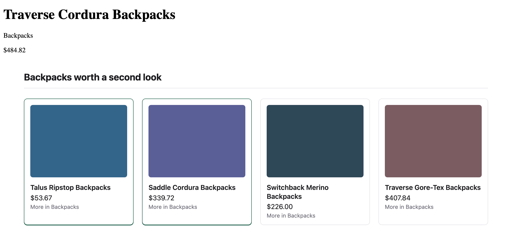

# rudra-js

rudra-js is an open-source TypeScript library (MIT) you install from npm. A language model designs one product-recommendation block for a page in your shop, rudra-js checks it against your catalog, and React renders it.

It is not a hosted platform, a visual or low-code app builder, or a workspace you sign up for.

[Docs](https://rudrajs.com) · [npm](https://www.npmjs.com/package/@rudra-js/core) · [Demo shop](https://demo.rudrajs.com/product/RJ-00001?shopper=S-0001)

If a language model writes raw HTML, it can make up a price or show a product you don't sell. So
rudra-js never lets the model write HTML. The model returns a spec instead: a short description of
the block, using only fields rudra-js defines. The model picks the layout. It writes the headline
and the copy. There is no field for a price, a product name, an image or a link. The model names
products only by SKU, and only from the list you give it.



`@rudra-js/react` turns the spec into HTML. It reads each product's title, price, image and link
from your catalog as the page is served. Anything the model wrote is rendered as escaped text.

rudra-js also checks every word the model writes, in three passes:

- Patterns for prices, discounts, ratings, delivery dates and stock counts.
- A digit check. Every digit in a sentence must come from your own input, as a category or a tag
  on one of the products the model was shown.
- A list of claims that carry no number to check, like "top pick" and "customer favourite".

Any field that fails a pass is dropped.

Two of the passes are word lists, so a rewording that's on neither list gets through. The digit
check only reads digits, so it misses a number spelled out in words. "Four and a half stars from
other hikers" gets past all three passes. The tests keep a list of rewordings that still pass, so
you can go and read how big the gap is. That's why the real defence is structural. The model is
never told a price, and the spec has nowhere to put one.

The block is in the first HTML response and needs no client-side JavaScript. So a crawler that
never runs JavaScript still reads it.

On our 500-shopper benchmark, the default mode makes 460 model calls per 1,000 page views.
Generating for every shopper would make 1,000.

> **Status: `0.8.3`, early.** It installs and it works. The Getting started below runs as a test on
> every commit. The public API might still change between minor versions before `1.0`. The
> changelog says when it does.

## Getting started

You don't need an API key to start. Leave the provider out and `@rudra-js/core` builds the block
itself, with no model. That's a fully supported setting, and the right one until you've settled on
a model.

```sh
npm install @rudra-js/core@latest @rudra-js/react@latest @rudra-js/attested@latest
```

Use this one command for a new app and for an app that already uses rudra-js. It's also how you
upgrade. If your app has `@rudra-js/anthropic`, add it to the command with `@latest` too. If it has
`@rudra-js/a2ui`, use the install line in that package's README instead. That line also names the
two A2UI packages.

The `@rudra-js` packages are published together. Each one's peer ranges on the others start at its
own version. With a bare package name, npm stays inside the range your `package.json` already has.
So without `@latest`, an app on an older core can get an `ERESOLVE` error.

Every package is under the `@rudra-js` scope. The unscoped `rudra-js` package on npm belongs to
someone else, so include the `@`.

You don't need to install zod. `@rudra-js/core` brings zod 4 as a dependency. If your app is
already on zod 4, it shares that copy. On zod 3, npm puts a zod 4 under core, and another under
`@rudra-js/anthropic` if you use it. Your zod 3 can't mix with the schemas core exports.
`productSchema.array()` works, but your `z.array(productSchema)` won't.

You need React 18 or 19. You don't need Server Components. `@rudra-js/react` is plain React with no
hooks. It works with `renderToString` and in a client-rendered app. Where your framework supports
Server Components, it works as one too. Render it on the server to put the block in the first HTML
response.

You also need Node 22.12 or later. Node 20 is end of life, so we don't build or test on it.

```tsx
import { createComponentGenerator, parseTrackingInput } from '@rudra-js/core';
import { RudraComponent } from '@rudra-js/react';

const catalog = [
  { sku: 'A-1', title: 'Cast iron skillet', category: 'Cookware', price: 39, currency: 'USD' },
  { sku: 'A-2', title: 'Enamel dutch oven', category: 'Cookware', price: 89, currency: 'USD' },
  { sku: 'A-3', title: 'Chef knife', category: 'Knives', price: 55, currency: 'USD' },
];

async function recommendations() {
  // Passing no provider means no API key and no spend.
  // Core builds the block itself, and the same input always gives the same block.
  const generator = createComponentGenerator({ provider: null });

  // Parsing fills in what you left out and rejects anything that doesn't belong.
  // Always pass the parsed candidates to the renderer, not your raw objects.
  const input = parseTrackingInput({
    user: { id: 'shopper-1' },
    context: { surface: 'pdp', currentSku: 'A-1', currentCategory: 'Cookware' },
    candidates: catalog,
    signals: { cart: [{ sku: 'A-2', at: Date.now() }] },
  });

  const spec = await generator.generate(input);

  return <RudraComponent spec={spec} products={input.candidates} locale="en-US" />;
}
```

A shopper looking at the skillet, with the dutch oven already in their cart, is shown the knife. It
sits under the heading "Goes with your cart". The product they're viewing and the one in their cart
are both left out. No model was asked, and nothing was billed.

In Next.js, add `export default recommendations` at the bottom of the sample to turn it into a page.

New Next.js apps from `create-next-app` turn Cache Components on. With it on, the build stops with
"Next.js encountered the unstable value `Date.now()` while prerendering". That's because the sample
and `generate` read the clock while the page renders. To fix it, create the app with
`npx create-next-app@latest my-shop --yes --no-cache-components`. Or delete `cacheComponents: true`
and `partialPrefetching: true` from `next.config.ts`. The
[quick start](https://rudrajs.com/learn/quick-start#cache-components) has more.

When you're ready for a model, add [`@rudra-js/anthropic`](packages/anthropic) and pass it as the
`provider`. Everything else above stays the same. The model then writes the wording. It also picks
the layout and the emphasis. By default, core still picks the products in a grid or carousel. It
picks them per request, from the candidates you pass in.

Before you send real shopper traffic, read
[Running it in a regulated shop](packages/core#running-it-in-a-regulated-shop).

The Anthropic adapter is one option. You can put any model behind the small interface described in
[Any provider](packages/core#any-provider).

If an [A2UI](https://a2ui.org) agent builds your pages, add [`@rudra-js/a2ui`](packages/a2ui) too.

## Packages

| Package                                     | What it does                                                                                                                    |
| ------------------------------------------- | ------------------------------------------------------------------------------------------------------------------------------- |
| [`@rudra-js/core`](packages/core)           | The schemas and logic that turn one tracking input into one spec you can render. The spec is checked with `@rudra-js/attested`. |
| [`@rudra-js/react`](packages/react)         | Renders the spec with React, on the server or in the browser.                                                                   |
| [`@rudra-js/anthropic`](packages/anthropic) | Talks to the Anthropic API. It's the only package that makes a billed call.                                                     |
| [`@rudra-js/attested`](packages/attested)   | Checks the model's copy against the facts a shop stands behind. Has no dependencies.                                            |
| [`@rudra-js/a2ui`](packages/a2ui)           | Lets an [A2UI](https://a2ui.org) agent place the block. Your server still picks the products.                                   |

## Development

You need Node `>=22.12` to work on the repo too. Node 20 also lacks the
`--experimental-strip-types` flag that `npm run verify:consumer` relies on. `.nvmrc` names an exact
Node 22. `engine-strict=true` turns a wrong Node version into a readable install error. CI runs the
checks on Node 22.12.0 and on the latest Node 22.

```sh
nvm use
npm install

npm run check        # all six of the below, in order

npm run build        # tsc -b across the workspace
npm run typecheck    # includes test files, which the build does not
npm run lint
npm run format:check
npm test
npm run verify:consumer   # packs every package and uses them from outside the repo
```

To see what each generation mode costs under a stub model, run
`ANTHROPIC_API_KEY= RUDRA_REPLAY_ONLY=1 npm run bench`. [bench/README.md](bench/README.md) explains
the columns.

If you keep a key exported in your shell, run the tests as `ANTHROPIC_API_KEY= npm test`.
`vitest.config.ts` sets `RUDRA_REPLAY_ONLY=1` for every test run. The shop throws at start-up when
that flag and a key are both set. So with a key in your shell, the test run fails to load instead
of spending money.

CI runs all six checks on every pull request. A second job builds the example shop and checks that
a crawler still sees the block as part of the page. CI sets no `RUDRA_SHOP_MODE`, so the shop
replays. That job runs the plain build:

```sh
npm run build --workspace @rudra-js/example-shop
npm run verify:crawlable
```

Locally, that build is safe on its own. Building calls no model. Serving the shop only spends money
with `RUDRA_SHOP_MODE=record`. The prefix below makes that a rule instead of a default:

```sh
ANTHROPIC_API_KEY= RUDRA_REPLAY_ONLY=1 npm run build --workspace @rudra-js/example-shop
```

## Example

[`examples/shop`](examples/shop) is a small Next.js storefront that runs rudra-js on a real page.
Its product page asks a language model for a recommendation block. The server renders the block
into the same HTML response as the page, so the block isn't fetched after the page loads.

```sh
npm run dev --workspace @rudra-js/example-shop
# then visit http://localhost:3000/product/RJ-00001?shopper=S-0001
```

That replays the transcripts committed under `examples/shop/recordings/`. A transcript is a saved
model call: the prompt and the model's answer. Replaying bills nothing, whatever keys you have in
your environment. `RUDRA_SHOP_MODE` is the switch, and `record` is the only value that spends money:

```sh
RUDRA_SHOP_MODE=record npm run dev --workspace @rudra-js/example-shop
```

That calls Claude once for each page that has no transcript yet. It saves each answer as a new
transcript. Pages that already have one still replay. So after the first visit, browsing a page
costs nothing.

[`examples/shop/README.md`](examples/shop/README.md) covers the rest:

- the environment variables
- how to re-record a transcript after a prompt change
- why the files under `recordings/` must only ever hold demo shoppers and demo catalogs

## Getting help

- **The docs**: guides and the API reference at [rudrajs.com](https://rudrajs.com).
- **Questions and ideas**: open an [issue](https://github.com/clivedsouza1010/rudra-js/issues).
- **Bugs**: open an [issue](https://github.com/clivedsouza1010/rudra-js/issues/new/choose).
- **Vulnerabilities**: report them privately. See [SECURITY.md](./SECURITY.md).

## Contributing

Contributions are welcome. [CONTRIBUTING.md](./CONTRIBUTING.md) covers setup and the scope the
project holds to. It also covers the naming and testing conventions. We expect everyone taking part
to follow the [code of conduct](./CODE_OF_CONDUCT.md).

The [changelog](./CHANGELOG.md) records the changes.

## Patent

Patent pending in the US. A provisional application for the cohort caching
design — the coupled cache key and prompt projection in
[`spec-cache.ts`](packages/core/src/spec-cache.ts) — was filed on 20 September
2026, application 64/158,649.

This doesn't change how you can use rudra-js. The code is MIT and stays MIT. The
application was filed defensively, so that nobody else patents the design and
comes after the people using it. A provisional isn't examined and may never
become a granted patent.

## Licence

[MIT](./LICENSE) © Clive Dsouza
